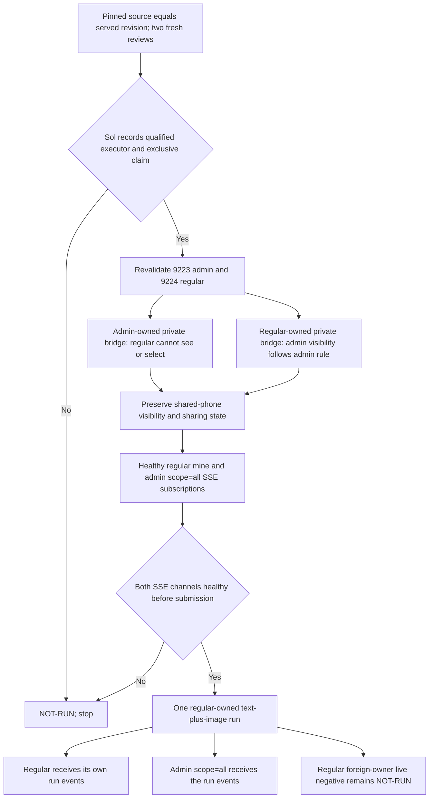

# CHE-1143 SmartQA private-phone and image-chat acceptance

Status: `PROVISIONAL`, `NOT-RUN`. This packet is a testcase specification. It is not device admission, browser acceptance, provider evidence, or a qualification result.

## Pinned inputs

- Artemis runner and SmartQA source revision: `68eab0af80eecb12e5d9fcc05a8e5635b31aff94` from `https://github.com/cheese-work/artemis`.
- The same source revision pins `apps/admin_console` and `apps/showcase_ui`. This is a source pin, not a verified serving revision. Read the served revision before browser acceptance; stop if it differs.
- Python dependencies: `uv.lock`, SHA-256 `fecfe4364bc321e2a77febf0616b878e38f8daacabee6aea345058e9fc523351`.
- Browser dependencies: `apps/showcase_ui/package-lock.json`, SHA-256 `2e4aebe81458df7615678be7353b625bfffb96a0876f11c4db16f03164569874`.
- Synthetic image input: `tests/tools/inputs/screenshot.jpg`, SHA-256 `1e6bbc31b77abf4701b6c54466e4feda1e816af45ba19b78a5af9d90f1ccd891`.
- The immutable testcase revision is the published PR head SHA. The companion candidate receipt pins this journey by digest. Both independent testcase decisions must name that same PR head before execution.

## Existing coverage to reuse

- **BUG-001:** `tests/unit/admin_console/test_device_stream_scope.py` already covers owner/admin visibility, another-QA denial, frame filtering, and shared-phone visibility. `tests/unit/admin_console/test_task_device_readiness.py` and `tests/unit/admin_console/test_run_device_binding.py` cover admission/binding behavior. These are source regressions, not private-browser-phone acceptance.
- **BUG-002:** `tests/unit/admin_console/test_run_ownership.py` covers per-row background-event filtering and owner-only named lifecycle events. `tests/unit/admin_console/test_preview_routes.py::test_status_shows_each_qa_only_their_own_queue` covers synthetic QA queue scope. These are source regressions, not live browser-event evidence.
- **REQ-003:** `apps/showcase_ui/src/app/pages/workspace/workspace-image-chat.spec.ts` covers attach, preview/removal, file-type limits, text-plus-image submission, and retry identity. `tests/unit/admin_console/test_run_images.py` covers accepted formats, rejection, queue payloads, ownership, and worker delivery. These tests do not prove a real provider received the image.
- No test in this packet claims those existing tests passed during authoring.

## Authorized synthetic setup

Use only the existing isolated preview route documented in `docs/preview-fixtures.md`: `ARTEMIS_PREVIEW_PROFILE=1` and `ARTEMIS_PREVIEW_IDENTITY_SWITCH=1`, with the fixed aliases `qa-a`, `qa-b`, and `admin` mapped to `qa-a@example.test`, `qa-b@example.test`, and `admin@example.test`. The preview owner supplies any already-created private preview URL and fixture location. Use separate browser contexts and the preview identity cookie. Do not use real QA accounts, credentials, Cloudflare sign-in, or production data for synthetic checks.

The synthetic preview returns an empty device list and disables device, provider, lifecycle, and real task-execution routes. It cannot prove private-phone isolation, owner-filtered live events, or image delivery to a provider. Do not substitute synthetic or shared-AVD evidence for the private-browser-phone case. No preview is started by this authoring packet.

## Compatible target and admission

- **Target class:** MBP-hosted Chrome with one physical Pixel 6 Pro connected through the owner browser's private phone bridge. Prefer USB; wireless is the backup. Do not use a shared AVD for this coverage.
- **Admission owner:** `x99-codex-sol` selects a qualified dedicated Android-squad executor and records an exclusive claim before any device command. The host identifier, exact phone serial, owner-bound bridge serials, claim/run owner, claim state, and private evidence destination are not supplied in this packet.
- **Role contract:** session `9223` (`thean13321@gmail.com`) remains admin; session `9224` (`lanlan78930@gmail.com`) remains regular. Revalidate both with read-only `GET /api/system/whoami` at the verified serving revision. Stop if either role differs. Do not change account roles or `ARTEMIS_ADMIN_EMAILS`.
- **Owner-bound phone observations:** cover both an admin-owned private bridge and a regular-owned private bridge. Reuse the one claimed physical Pixel 6 Pro in separate owner-bound browser contexts only if Sol's exclusive claim explicitly permits the sequential bridge sessions and binds each bridge serial to that physical serial without changing account roles or device-sharing state. Otherwise, mark the unavailable direction `NOT-RUN`; do not infer it from the other direction or substitute a shared AVD.
- **Provider gate:** Cheese's USD 5 authorization and owner approval for accounts 5–7 remain recorded for one combined text-plus-image provider run. Use no provider until Hermes verifies an eligible selected account, live binding, and enforceable run-scoped limit. Do not treat the USD 5 authorization as approval for additional qualification calls. New Anthropic Android runs remain halted. A gateway reachability result is not provider acceptance.
- **Review gate:** two independent non-author reviewers selected under the live Android-squad policy must approve the exact immutable PR head before any execution, including first-class device-class qualification. Material changes require both decisions again.

## Cases

### BUG-001 — Private browser-phone isolation

1. At the verified serving revision, revalidate session `9223` as admin and session `9224` as regular with read-only `GET /api/system/whoami`. Stop if either role differs. Do not provision accounts, access credentials, demote either identity, or change `ARTEMIS_ADMIN_EMAILS`.
2. After Sol records admission, establish the admin-owned observation in the already-authorized `9223` browser context. Use only the phone and synthetic screen authorized by Sol's claim. Verify the admin sees its own private phone in `app-workspace-device-chip button[aria-haspopup="true"]` and `[role="group"][aria-label="Phones"] button.option`.
3. In the separate regular `9224` context, verify the admin-owned private phone is absent and unselectable. Read `GET /api/stream/device-state` and the live-frame stream only when its first-connected ADB serial matches the admin bridge serial recorded in Sol's claim. Require the regular response to be `{"connected":false,"serial":null,"live_stream_url":null}` and no frame from that private phone. Stop before any `/api/run` request from the regular context.
4. Establish the regular-owned observation only if the same exclusive claim explicitly permits a sequential owner-bound bridge session for `9224` on the claimed physical Pixel 6 Pro without changing sharing state or either account role. Verify the regular sees its own phone. Verify the admin sees and may select the regular-owned private phone under the existing admin rule. Bind the observed bridge serial to the same claimed physical serial. If the claim cannot support this observation or its ADB serial does not match, mark this direction `NOT-RUN`; do not reorder ADB.
5. The safe pre-enqueue negative control is the regular `9224` selector check against the admin-owned private phone in step 3. It proves UI-level prevention only. The server-side target-control contract remains `UNKNOWN` and `NOT-RUN`. Do not send a host-bound request until Sol verifies the serving revision and approves a reviewed control that proves rejection before enqueue and before any device command.
6. Verify an explicitly shared lab phone remains visible to both accounts. Do not alter its sharing state or reset shared ADB. Preserve allowed read-only share-link access.

**Provisional evidence:** both role directions require paired owner/non-owner browser observations, the exact physical and bridge serial mapping in Sol's claim, privacy-safe target labels, read-only stream-state responses, and serving revision. One observed direction does not pass the full case. This does not cover server-side task-control authorization. Keep that control `NOT-RUN` until the serving contract is verified and a reviewed negative control proves rejection before enqueue and before any device command. Regular-to-regular isolation remains unproven; do not request a third QA unless Sol determines that coverage is required.

### BUG-002 — Owner-filtered events

1. Use regular session `9224` and admin session `9223` in separate already-authorized browser contexts. Before submission, open `GET /api/stream/active` as regular `9224` (`scope=mine`) and `GET /api/stream/active?scope=all` as admin `9223`. Require HTTP `200`, open streams, and the initial `info` message `Subscribed to session active` in both. Record both handshakes. If either channel is unhealthy, do not submit the run and record `NOT-RUN`.
2. After both handshakes, submit only the regular `9224` text-plus-image run described in REQ-003. Keep both SSE connections open and capture continuously. The pinned route emits `event: keep-alive` with `{}` after each 5.0-second wait with no queued event. During every quiet interval, require and timestamp that keep-alive on each channel. Require the regular `scope=mine` stream to receive positive run-scoped evidence for the exact run, including `session_started` and `session_ended`. Require the admin `scope=all` stream to receive that same run's events under the existing admin rule.
3. Keep both captures open through the regular owner's `session_ended` event, with a hard limit of 900 seconds after submission. If either stream disconnects, either channel misses its expected keep-alive during a quiet interval, or the 900-second limit arrives before the terminal event, record `NOT-RUN`; do not accept silence as evidence of owner filtering. Do not reconnect and do not add another provider run for event capture.
4. Fail the regular stream assertion if it contains a session-bound event or run identifier that does not belong to session `9224`. This single regular-owned run positively checks the regular owner stream and the admin all-scope rule. It does not independently demonstrate suppression of a deliberately generated admin-owned event from the regular stream; keep that live negative `NOT-RUN` rather than adding another provider run. Existing source regression coverage does not count as live event evidence.
5. Preserve read-only access through any already-authorized share link. Do not create, revoke, or modify a link. If no owner-supplied link fixture exists, record this control as `NOT-RUN`.

**Pass evidence:** both successful subscription handshakes; timestamped keep-alive health on both channels during every quiet interval; continuous captures tied to the same regular-owned run ID; regular `9224` positive `session_started` and `session_ended` evidence within 900 seconds; admin `9223` all-scope receipt of that run's events; no foreign session-bound event in the regular capture; and a separate record that the allowed share-link read was preserved or `NOT-RUN` because no authorized link fixture was supplied. The live regular-versus-admin event suppression negative remains a stated coverage gap.

### REQ-003 — Image delivery in the current conversation

1. Use the pinned synthetic JPEG fixture. Stage it only through an action permitted by Sol's claim; verify its digest after staging.
2. In regular session `9224`'s current conversation, use `button[aria-label="Attach images"]` and `input[aria-label="Choose images to attach"]`. Verify the preview has alt text `Preview of screenshot.jpg`. Verify `button[aria-label="Remove screenshot.jpg"]` removes the selected image before reattaching it for the send.
3. Enter: `What date does the yellow instruction ask me to select? Reply with only the date.` Submit the sole regular-owned run through `button[aria-label="Start task"]` only after both BUG-002 subscriptions are healthy and the provider route and run-scoped spend enforcement are verified. The one recorded USD 5 authorization applies to this single combined text-plus-image provider run only.
4. Verify the same request contains the text and pinned JPEG, the returned assistant answer is `11/07/2016`, and the answer and image belong to regular session `9224`'s current conversation. Confirm the matching event is visible in the regular `scope=mine` stream and admin `scope=all` stream. Do not claim that this run proves suppression of an admin-owned event from the regular stream.

**Pass evidence:** fixture digest, same-request text and image evidence, current conversation/run ID, provider-call evidence with no credential values, returned answer, owner/non-owner event observations, and the served app revision.

## Negative controls and qualification

- Reuse the existing unsupported/malformed/oversize image regressions; they must reject before enqueue or provider activity. Do not duplicate them in a second source-level suite.
- The live non-owner phone-control contract is `UNKNOWN` and `NOT-RUN`. The safe pre-enqueue control is the read-only regular-9224 selector denial in BUG-001; it must stop before `/api/run`, enqueue, or device command. It does not prove server-side task-control authorization. The pinned source's `host_id` branch bypasses `require_device`; do not send a host-bound request or claim that the branch denies it. Sol must verify the serving revision and approve a separate reviewed control that proves rejection before enqueue and before any device command. Shared-device visibility and authorized share-link reads are preservation controls, not denials.
- First-class qualification is `BLOCKED` and `NOT-RUN` if Sol determines it applies to this target class. The missing reviewed representative case is `CHE-1143-MBP-Chrome-Pixel6Pro-qualification`: it must bind the nominated MBP Chrome host and already-authorized regular session `9224` browser profile, verified protected-site URL and serving revision, the regular `9224` conversation, the staged JPEG with the pinned digest, and the exact physical Pixel 6 Pro plus owner bridge serial mapping in Sol's exclusive claim. It must specify one clean representative pass, a clean rerun, and a deliberate failure control on the same immutable testcase and runner revisions.
- For the deliberate failure control, copy the representative case and change only the expected answer assertion from `11/07/2016` to `11/07/2017`. The expected result is exactly one failed answer assertion naming expected `11/07/2017` and observed `11/07/2016`; the runner must exit nonzero. Preserve the raw failure artifact in Sol's authorized evidence directory before evaluating or approving it. No reviewed browser-capable runner command currently binds the required Chrome context, URL, conversation, image, and claimed phone. `artemis run --device-serial` selects an Android target and does not bind that browser context; do not use it for this qualification. Keep qualification `BLOCKED` until the missing case pins a compatible command and both independent reviewers approve the same immutable revision. Run no qualification control during authoring. Include any provider use inside the recorded numeric spend scope; Anthropic Android runs remain halted.
- Do not execute a control against a real phone or provider during authoring.

If an authorized run encounters a C00 HTTP 502 or 503, do not retry or poll. Create one 1-hour wakeup, then stop.

## Cleanup and evidence

- Preserve traces, screenshots, response records, and the exact testcase/runner/app revisions before cleanup. Redact credentials and personal data.
- Stop only run-owned work. Close only the test browser contexts. Remove the staged JPEG only if this run created that exact staged file. Remove only the disposable preview child created for the run.
- Do not clear personal app data, restart shared ADB, or alter shared-device, account, identity, route, Cloudflare, or share-link state.
- Sol verifies phone release. If cleanup is uncertain, keep the target unavailable and name the recovery owner.
- Return commands, exit status, host, serial, claim, app serving revision, run IDs, artifacts, first attempt/rerun/negative-control outcomes, and cleanup evidence to CHE-1143. Classify each unexecuted case as `NOT-RUN`, not `PASS`.
