# DLP-1 authority cutover preparation (CHE-4519)

This is a development runbook for CHE-4285 Authority 1 and SmartQA phase 3.
The implementation and tests perform no live cutover or device command.
Phase 3 execution requires Cheese's recorded G4 approval. Cheese merges.
Restricted devices, `500c592`, G5 and CHE-2082 privacy rules stay in force.
No broker or adapter may restart shared ADB.

## Preconditions

Pin the exact broker, gateway and SmartQA build SHAs in the approval packet.
Preserve the private SQLite database, audit JSONL and change journal together.
Record the authoritative name/generation and quarantine owners/issues using
`Authority.readback()`. Epoch timestamps in stored groups stay machine evidence;
render operator-facing timestamps in ICT.

There is one host-wide database and one exclusive owner. SmartQA must use this
same domain/store, not the separate legacy CHE-2099 allocator. Both callers use
the same admission guard and current Artemis execution-lock/Android claim
readers. A per-client choice of allocator is forbidden. Unknown readiness or
identity closes admission. The shipped development daemon still admits nothing.

Every gateway connection must pass R1's complete authenticated per-run credential
check first. Its verified authority name/generation feeds the single owner's
`GenerationGate.gateway(name, generation, shared)` factory. `shared` contains
only the lease's currently allowed serials/transport mapping; restricted devices
still require the audited route or no access. The generation gate is an extra
check, not authentication or permission to expose a listener. The factory reuses
`artemis.runtime.adb_gateway.Gateway`; no second smart-socket parser is introduced.
It registers both stream ends and unregisters them when the relay exits.

Keep one GenerationGate registry for every listener owned by this authority.
With multiple gateway processes, first stop new ingress and collect confirmed
closure of every process's streams through an owner-controlled adapter. This
single-process preparation API does not coordinate multiple registries. Do not
acknowledge one registry as closure of other listeners. Stop incompatible old
binaries/allocators before proceeding; a legacy binary that ignores generations
cannot be fenced by a database flag alone. No host isolation or production
gateway wiring is installed by this change (slice 5 owns R1).

## Drain, carry quarantine, fence, enable, read back

These are trusted in-process owner hooks, absent from holder RPC and HTTP routes.
The operator authenticates G4 authority before calling them. `broker` below is
the existing owner instance; `gate` is its existing complete gateway registry.

1. **Drain.** Call `control = Authority(broker, actor=OPS_ID, run_id=OPS_RUN_ID, issue=APPROVAL_ISSUE)` and
   `control.drain("broker", current_generation)`. Read back `state=draining`.
   Drain persists across client instances and owner restart. It refuses acquire,
   claim and renew before any idempotent replay. Existing leases may finish;
   release/expiry still fence and recover. Drain does not close active streams.
2. **Carry quarantine.** Save the readback's complete `quarantine` list and each
   lease id, canonical device id, recovery owner and ops issue. Keep the same
   database. Quarantine, cleanup intents, verification and run budgets are retained
   in place. Quarantine never becomes free through generation change.
3. **Fence.** Call
   `control.fence("broker", current_generation, "smartqa", gate=gate)`.
   Only a drained authority may bump. One transaction switches to the successor
   name, increments the generation and records `state=fenced`. It fences active
   groups, clears outstanding offer reservations and retains the recovery barrier.
   After commit, the gateway closes every old stream. New old-generation access
   is refused immediately, including host-wide discovery services. The closure
   acknowledgment is persisted only after all stream closes succeed. A failed
   close leaves enable blocked; retry this same call without another bump.
4. **Resolve and enable.** Run the existing foreground recovery path. Gateway
   stream closure alone does not prove old device processes/reverse forwards
   stopped. Recovery must stop only tracked old-run work, undo only recorded
   allowed changes and retain evidence. Leader-verified release (rule 9) stays
   mandatory: `verifying` still blocks enable. Uncertain recovery becomes
   quarantine with its named owner and ops issue. Only after every old group is
   `released` or `quarantine`, call
   `control.enable("smartqa", current_generation + 1)`. Missing gateway closure,
   unresolved old leases or unhealthy audit refuses enable. No TTL-only release.
5. **Read back.** Confirm the expected name, incremented generation, `enabled`,
   `fenced=1`, no unresolved groups and the unchanged prior quarantine ownership.
   Compose SmartQA with `authority_name="smartqa"` and that exact
   `authority_generation`; stale broker instances cannot grant, renew or claim,
   even with a previously successful idempotency key. Inspect the transactional
   authority audit events and retained device recovery evidence. The successor
   still checks every existing claim, grant and quarantine before admission.

```mermaid
stateDiagram-v2
    [*] --> EnabledBroker
    EnabledBroker --> Draining: G4 owner drain
    Draining --> FencedSuccessor: increment generation; retain quarantine
    FencedSuccessor --> FencedSuccessor: close streams and resolve old leases
    FencedSuccessor --> EnabledSmartQA: closure acknowledged; only released or quarantine
```



## Failure and reversal

If a step fails, read back before retrying. Keep ingress closed and do not enable
another allocator. A crash after the generation commit leaves `fenced` persisted;
reconcile gateway sessions before acknowledging closure. Startup still fences
active leases and reconciles them before new admission. Missing, unreadable or
unrecognized generation state denies gateway access.

Do not restore an older generation or reset ownership from a backup. To reverse
an enabled cutover, drain SmartQA, retain quarantine, fence to a newer generation
with successor `broker`, resolve old work, enable broker and read back again.
That live reversal also needs applicable G4 approval. Preserve rollback builds
and all recovery/audit evidence. No live execution is qualified by fake tests.

## Hermetic verification

```sh
TMPDIR=/tmp python3 -m unittest discover -s tests/unit/runtime -p 'test_device_lease*.py' -v
```

Tests use synthetic devices, fake clocks/streams and fake Multica. They check
old grant/renew/claim refusal, persisted drain, generation-filtered services,
stream closure, unresolved-lease enable refusal and quarantine ownership.
