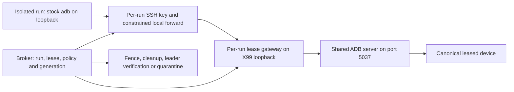

# Remote ADB R1: isolated-agent design

Revision 2: closes CHE-4532 findings F1–F5 on network adbd bypass,
feature replies, key replay, log redaction and loopback access enforcement.
This note specifies slice 5b (CHE-4513); it does not implement or enable R1.
Live SSH, firewall, USB isolation and device execution are **NOT-RUN**.

Source: **DLP-1 rev 4**, section **Remote ADB for isolated agents (R1,
security-critical)**, frozen plan SHA256
`bb6cd030161b46e0ec6b77a101d7f0cd3a7f37727d82e52527060727cc34e86b`.
The plan passed CHE-4430 at 8 Nov 2026 02:28 ICT, verdict comment
`01a1b77c-e6ab-7c1b-8833-39e587fa4008`.
Rule headings below cite the exact R1 bullet; supporting DLP-1 rules stay named.
These are implementation requirements for this candidate, not new standing
instructions or permission to use a device.



## Authentication and credential lifetime

**R1-A1 — Bind possession to authority.** (DLP-1 R1: Authentication)
Use a fresh ephemeral SSH key per claiming run and lease group. The broker
records its public-key fingerprint against the authenticated principal, agent,
issue, live run id, lease group id, canonical allowed device ids, credential
expiry and authority generation. Authenticate the control request through the
broker's trusted principal and live-run lookup from slices 3a/3b;
caller-supplied ids alone are not proof.
Grant only after an active lease and live run are verified. Offered or parked
tickets get no key or listener (DLP-1 Waiting and resume 5–6). Unknown or
unavailable authority, run or device policy fails closed.

**R1-A2 — Validate the current binding.** (DLP-1 R1: Authentication)
Check that tuple at SSH authentication, each forwarded connection, each
smart-socket service dispatch, and throughout stream lifetime via broker
fencing and a local expiry deadline. The key is the credential; a lease id,
IP address, container NAT address or shared tailnet node is not. Tailnet ACLs
add a network boundary only. A copied key remains a bearer secret, so protect
the private key in the run's private, mode-0600 temporary directory, never in
argv, logs, Git or issue evidence. The broker stores only public material.
Dispose of the run's private key at end of access; deletion alone is not fencing.

**R1-A3 — Never revive old credentials.** (DLP-1 R1: Authentication)
Reacquire, successor claim and authority change require a fresh key and listener
binding, even for the same principal, device or run. Never reassign an old key.
Reject any public-key fingerprint ever bound before, including a key submitted
again by its former principal. Keep durable fingerprint tombstones across
release, restart and authority migration; an unavailable replay history fails
closed. The tombstone check and new binding are atomic, so concurrent key
registration cannot reuse a fingerprint. An idempotent retry returns only the
existing still-active binding; it cannot register the key for another lease.
Credential expiry is no later than the lease expiry and hard cap; renew cannot
extend it silently. An authenticated successful renew can issue a replacement
key, invalidate the old key and close its sessions before retiring its listener.
Failure to rotate leaves the old deadline in force, never extra access.
Remote heartbeats are authenticated, every 30 s; 90 s without liveness triggers
fencing, not a conclusion that device work stopped (DLP-1 Rules 5–7).

## Constrained SSH tunnel

**R1-T1 — Give each key one destination.** (DLP-1 R1: Tunnel)
Use an ops-managed SSH service under a dedicated unprivileged tunnel account,
separate from agent accounts and USB/ADB authority. Each key permits local
TCP forwarding only to its own broker-created `127.0.0.1:<gateway-port>`.
Use key restrictions equivalent to `restrict,port-forwarding,permitopen=...`
plus server policy: `AllowTcpForwarding local`, `AllowStreamLocalForwarding no`,
`MaxSessions 0`, `PermitTunnel no`, no agent/X11 forwarding, no PTY and no
remote forwarding. Session channels, shell, exec, SFTP and subsystem requests
are denied. Do not enable a generic host SSH account as a substitute.
The allow destination is never port 5037, another lease's listener, a wildcard
or a user-chosen address. The SSH configuration and effective key restrictions
need ops validation before rollout; no configuration change occurs here.

**R1-T2 — Keep the client endpoint private.** (DLP-1 R1: Tunnel)
The run uses an SSH local forward bound to its own `127.0.0.1` in its private
network namespace. Set `ADB_SERVER_SOCKET=tcp:127.0.0.1:<local-port>` for stock
adb. Require pinned SSH host keys, strict host-key checking, only the per-run
identity and no connection multiplexing across runs. The SSH destination
restriction binds authentication to one listener; the listener does not infer
identity from a loopback source address. Every connection through that listener
inherits the immutable key/lease tuple and revalidates its live authorization.
The endpoint must fail closed if the tunnel is absent; never fall back to the
default server. No agent runs `adb kill-server` or `adb start-server`.

## OS and network isolation

**R1-I1 — Enforce both paths outside the agent.** (DLP-1 R1: Isolation)
Ops owns the host network and OS boundary. Containers use a separate network
namespace, no host networking, no privileged mode, no host PID namespace, no
network/admin capabilities and no mounts of host sockets, credentials, ADB
keys or `/dev/bus/usb`. Device permissions/cgroups deny USB; agents cannot join
the ADB-authorized group or tunnel account. Host rules reject agent traffic
to port 5037 on every host interface, address family, bridge and host-gateway
alias. Enforce a host loopback OUTPUT owner match for the registered gateway
ports: allow only the tunnel account UID, then reject every other UID on
IPv4/IPv6 loopback, including ordinary host processes outside containers.
Agent runtimes cannot become that UID or change these ops-owned rules.
Reserve ports and install the rule before listening; retain it through session
reconciliation and port retirement. Remote agents get
only the constrained SSH ingress, never exposed ADB or gateway listeners.
Run namespaces also deny ingress from other runs to local-forward listeners,
even if an agent binds a local forward to a non-loopback address.
Also deny every direct route to device-facing networks from isolated agents,
including port 5555 and all dynamic wireless-debugging pairing/connect ports.
Cover IPv4, IPv6, LAN, bridge NAT, tailnet, aliases and alternate interfaces.
Use host-controlled default-deny egress with explicit broker/control/service
exceptions, never an exception for an entire device-facing address or subnet.
Only the constrained SSH service is reachable on a host that also routes to
devices. Apply the equivalent boundary at remote isolated-runner hosts; a
runner whose routes cannot be controlled is not admitted to R1. Device-facing
network rules also deny device-originated access to shared port 5037.
An allowed device shell/UI can enable network adbd or pair a key; service-name
denials alone cannot stop that path. Direct network access stays denied even
while the lease is active and after the gateway has closed.
A shared UID or access to a host container daemon is
not an isolation boundary. Same-user local agents remain cooperative under
DLP-1 Rule 1; this design does not claim they are isolated.

**R1-I2 — Prove the deployment boundary separately.** (DLP-1 R1: Isolation)
Slice 5b uses fakes for control/data paths. Before live isolated-agent rollout,
ops must provide effective SSH restrictions, network/device permission evidence
and attempted bypass results from the actual isolated runtime. Include the
effective loopback owner rule: the tunnel UID can reach its registered gateway
port, while an agent UID on the host or in a container cannot. Prove denial of
device network adbd through every available route and dynamic port class.
Use a separately authorized positive control to prove the fixture is reachable
when the isolation rule is absent; never remove live isolation for this check.
Missing evidence
means R1 is disabled, not an insecure direct-connect fallback. No live device
probe is authorized by this note; device work follows Android squad admission,
claim, scoped grant, immutable testcase review and executor rules.

## Gateway reuse and service policy

**R1-G1 — Extend the shared gateway.** (DLP-1 R1: Gateway)
Reuse `artemis/runtime/adb_gateway.py`: `read_message`, `read_exact`, `text`,
`filter_devices`, and `Gateway.relay`/`allows`. No second parser.
Reuse stream ownership and closure from
`apps/admin_console/services/host_tunnel.py`: `clients`, `client_streams`,
`tasks`, listener close, cancellation and close completion. Add the lease
authorization/policy hook in the shared path with existing callers preserved;
the lease adapter supplies authorization, not another smart-socket decoder.
For R1, log only the service family and decision, with permitted lease/run
identifiers. Replace the reused relay's `service[:128]` denial logging in the
R1 path; sanitizing only the audit sink is insufficient. Never log raw service
strings, shell/exec arguments, sync paths or parser error payloads on any
allow/deny/error path. Test application logs as well as the audit output.
No shared symbol changes occur in slice 5a.

At source base `41374d3d17888f968b4cefa095ac8e36f627e4ec`, `Gateway` filters
serials but has no principal/run/expiry policy. Its device-service prefixes
are broad; `HostTunnel.unshare` closes selected serial streams only.
`HostTunnel._close` closes the whole tunnel. These are reuse points, not proof
that existing code enforces R1. B2 reconnect grace (`CONTRACT.grace_seconds`)
does not grant DLP-1 post-expiry grace: R1 has zero access grace.

**R1-G2 — Resolve identity before transport.** (DLP-1 R1: Gateway)
Resolve each lease's canonical device id through the registry to the current
host/serial/transport mapping, including USB/wireless deduplication. Pin the
mapping revision for the stream. A mapping change, disconnect, alias collision
or loss of authorization fences the affected binding; never silently follow a
new transport or widen the set. Discovery/track responses show only leased,
currently authorized serials. Reject a hidden serial before any upstream write.
Transport ids are output metadata, not transferable authority.

**R1-G3 — Allow exact service families and deny the rest.** (DLP-1 R1: Gateway)
The table applies only after R1-A2, R1-G2 and the restricted-device check below.
`<serial>` means the validated current lease mapping, never arbitrary input.

| Phase/service | R1 decision and response contract |
| --- | --- |
| `host:version` | Allow bounded server protocol metadata. |
| `host:features` | Synthesize the bounded reply locally from the per-lease approved feature set (R1-G5). No implicit upstream device selection. |
| `host:devices`, `host:devices-l`, `host:track-devices`, `host:track-devices-l` | Allow; filter every snapshot/update, including removal and empty lists. Track streams remain owned by the lease even before serial selection. |
| `host:transport:<serial>` | Allow validated explicit selection; `OKAY`, then device service. |
| `host:tport:serial:<serial>` | Allow validated explicit selection; `OKAY` plus exactly 8 raw transport-id bytes, then device service. Never accept the returned id as a later selector. |
| `host-serial:<serial>:features` | Validate the explicit leased mapping and synthesize the bounded per-lease approved reply (R1-G5), never pass upstream features through. |
| `host-serial:<serial>:get-state`, `host-serial:<serial>:get-serialno` | Allow exact scoped commands; bounded length-prefixed reply. Parse serials containing `:` with the existing parser. |
| `host-serial:<serial>:wait-for-*` | Allow only the existing `_WAIT_SERVICE` grammar, still scoped to the exact serial. Relay the second `OKAY` or bounded `FAIL`; expiry cancels a pending wait. No global wait or suffix injection. |
| After selection: `shell:`, `shell,`, `exec:`, `abb_exec:`, `sync:`, `framebuffer:` | Allow only on an unrestricted, granted device. NUL-separated `abb_exec:` arguments are allowed only as already parsed after explicit selection; metadata and other commands reject NUL. Device streams remain revocable after raw relay begins. |
| After selection: `tcp:`, `localabstract:` | Deny in the initial R1 profile; the shared B2 gateway's broader allowance does not opt these into R1. A later explicit scoped service policy needs review. |
| Global controls and forwards | Deny `host:kill`, `host:connect`, `host:disconnect`, `host:list-forward`, all host/serial `forward` and `killforward` forms, device `reverse:*`, root, remount, reboot and tcpip services. No arbitrary forwarding. |
| Implicit/id selectors and unknown services | Deny `host:transport-any`, `host:transport-usb`, `host:transport-local`, `host:transport-id:*`, `host:tport:any`, `host:tport:usb`, `host:tport:local`, unvalidated id forms and every unlisted service, before upstream dispatch. |

**R1-G4 — Restricted devices have no raw route.** (DLP-1 R1: Gateway)
Check restriction and grant before issuing any raw gateway credential, then
again on dispatch and policy change. A restricted device uses the separate
audited CHE-2129 command route, or nothing (DLP-1 Eligibility and restricted
devices). Do not attempt a shell-string allowlist in this tunnel: `exec:`,
shell v2, `abb_exec:`, sync, device sockets and aliases can bypass it.
`500c592` stays unavailable for raw ADB until Cheese confirms identity and
grants it (G5, CHE-2082). Unknown policy fails closed. Pool membership or root
capability never supplies a grant; this design grants no root authority.

**R1-G5 — Pin client behavior and feature negotiation.** (DLP-1 R1: Gateway)
Initial stock client target: **adb 37.0.0-14910828**, protocol 1.0.41, matching
`tests/support/golden/adb_protocol.json` at the source base. Slice 5b must
exercise that exact client against a fake ADB endpoint before claiming support.
Other client versions are unsupported until their fake-wire fixtures pass.
Supported features are explicit serial selection, filtered discovery/track,
scoped metadata/wait, legacy shell, shell v2, exec-out, sync and package-install
streams on unrestricted devices. R1 starts with an empty advertised optional
feature set (legacy fallback). Add `shell_v2`, `cmd`, `stat_v2` or `abb_exec`
advertisement only after slice 5b tests the negotiated path end to end; never
pass upstream feature lists through unchanged.
Synthesize both feature replies from the per-lease approved set.
Never send plain `host:features` upstream: the server can select an arbitrary
attached device. Compute optional features as the intersection of tested R1
features and explicitly queried, validated leased-device capabilities. The
unscoped reply uses the intersection across the authorized lease group; the
scoped reply uses that serial's approved intersection. Empty/unknown mappings
yield an empty local set or denial, never capabilities from an unleased device.
No upstream feature discovery is needed while the approved set is empty.
Do not advertise forwarding,
reverse forwarding or automatic reconnect. Device TCP/localabstract consumers
such as uiautomator2's HTTP connection are outside this initial R1 profile;
this note does not claim full Artemis/uiautomator2 workflow compatibility.

**R1-G6 — Bound parsing and stream resources.** (DLP-1 R1: Gateway)
Reuse the four-hex-digit smart-socket framing and strict UTF-8/control checks.
Cap text at `CONTRACT.max_text` (65535 bytes), per pending request at the
4-byte header plus that payload, and partial header/payload completion at 5 s
from the first byte, without resetting the deadline for each fragment.
Valid fragmented and coalesced requests decode exactly once in order; their
arrival shape alone is not an error. Invalid length/encoding, illegal NUL,
truncation, timeout, malformed upstream status/reply and excess budget cause
a bounded `FAIL` when writable, then close; never partial upstream dispatch.
Once a device stream starts, bytes belong to that selected device protocol;
do not reinterpret raw shell/sync bytes as new host requests.
Apply shared `CONTRACT` limits: 32 streams per lease, 256 KiB stream credit,
4 MiB aggregate lease budget and 64 MiB process budget, preserving 64 KiB
control reserve. If mux framing is used, its 64 KiB frame cap includes its
17-byte header. SSH-backed streams still need those aggregate budgets and
backpressure; SSH buffering alone does not establish them. Admission and byte
caps apply before buffering/authenticated forwarding can allocate unbounded
work; use bounded SSH connection/channel limits and fair per-lease quotas.

## End of access and recovery

**R1-E1 — Fence every access path.** (DLP-1 R1: End of access)
Release, expiry, revoke, suspect/terminal holder, restriction/grant withdrawal
and authority change first make the lease non-admitting. Persist `Fencing`
and invalidate its keys. Serialize dispatch with the lease's fencing barrier,
so a prechecked request cannot enter upstream after the barrier. Then reject
new SSH/forwarded connections, stop its listener, close all SSH sessions and
all gateway streams, including discovery, waits, unselected and raw relays.
Await cancellation/closure and account for queued bytes before acknowledging
fencing. Deadline checks remain local even if the broker connection is lost;
control-path loss fences rather than continuing on a stale snapshot.
No network/device I/O runs inside the SQLite writer transaction (Authority 4).
Deleting an authorized key blocks new authentication only; it does not close
an already authenticated SSH connection or its future forwarding channels.
Keep a broker-owned inventory of exact per-run SSH session processes, start
identities, listener bindings and streams. Do not reuse a destination port
until every old session that could forward to it has been closed and verified.

**R1-E2 — Closing streams is not verified release.** (DLP-1 R1: End of access)
Track spawned device work and any previously recorded reverse forwards by
lease. Stop only owned work, validate process identity before stopping it,
and undo only recorded authorized changes. Missing ownership evidence,
failed closure, cleanup or verification sends the device to `Quarantine`
with a named recovery owner. The 2 min fencing/cleanup budget never returns
a device to `Eligible` automatically. Keep `Cleaning` then `Verifying` until
the Android squad leader verifies release under DLP-1 Rules 8–10.
Before granting raw access, obtain an authorized pre-lease attestation that
Wireless debugging is off, TCP adbd is off and the paired/authorized adb key
fingerprints form the known baseline. Missing access to attest these facts
makes the device ineligible for raw R1; this does not authorize root, new
privacy access or inspection of unrelated device data. Before `Eligible`,
verify that Wireless debugging is off and TCP adbd is off again, and that
paired/authorized adb key fingerprints match the pre-lease baseline.
Attest all relevant device users/profiles; store only state and fingerprint
digests in protected recovery evidence, never private keys or personal data.
Unknown state, a changed key set or an enabled network listener quarantines
the device even if every recorded cleanup action succeeded. Do not remove
unrecognized/pre-existing keys or reset network debugging automatically:
recovery needs the named authorized owner and leader verification. Closing a
gateway does not undo an unrecorded device pairing; the network denial in
R1-I1 remains enforced during recovery and after release.
Only Cheese or ops may revoke (Rule 5); automated fencing does not grant
agents arbitrary revoke or shared-server restart authority. Append redacted
ticket/lease/fence/cleanup/verification events with ICT time, agent, run,
issue and canonical device id (Rule 11); never log private credentials or
unrestricted command payloads.

**R1-B1 — Restart with admission closed.** (DLP-1 R1: Broker restart)
After broker restart, clock discontinuity or authority transition, invalidate
all pre-restart credentials and fence every previously active lease before
any grant (DLP-1 Rule 7). A new broker incarnation makes old bindings invalid
even if an authority generation number did not change. Use persisted session
inventory plus an ops-managed supervisor to stop old tunnel children on broker
death. Stop only the recorded per-run sessions; never stop a shared SSH service.
Reconcile orphan listeners, SSH sessions, streams and owned device work;
reused PIDs require start-time/boot-id verification. Unknown state quarantines
the device and leaves admission closed for the affected resources. A restart
never recreates an old session or imports B2 reconnect grace. Reopen admission
only after fencing and leader-verified recovery; issue fresh credentials on a
new live claim. SmartQA cutover still needs G4 and preserves quarantine.

**R1-X1 — Keep the rejected alternative rejected.** (DLP-1 R1: Rejected)
R2 (`adb tcpip` plus `adb connect` per device) is rejected: it exposes adbd
without a lease check at the edge. Never use R2 when SSH or isolation fails.
R3 (SmartQA API instead of raw ADB) remains a later option, not this slice.

## Slice 5b: tests to write first

This is a required coverage list, not authored executable Android testcases.
Slice 5b authors the unit tests using fake clocks, principal/run resolution,
devices, ADB streams, SSH sessions, policy and Multica. No live device command.
For each row, first observe the behavioral red, implement, then observe green.
Use an authorized unrestricted device/key as a positive control so a gateway
that denies everything cannot pass. Record upstream writes, open session and
stream counts, close completion, byte counters and recovery state.

| Case id | Setup and decisive assertions | Source |
| --- | --- | --- |
| `stale-credential-after-reacquire` | Reacquire the same device/run with a fresh key. DENY the old key and old SSH session, including a new channel on that session; no upstream write. The `old-key-registration` negative control submits the old fingerprint again, including concurrent registration and restart variants; it must not create a new binding. Accept a never-bound fresh key only for its current tuple; an idempotent active retry preserves that binding only. Also alter principal, issue, run, devices, expiry and generation individually; each mismatch denies. | DLP-1 R1: Authentication; R1-A1–A3 |
| `nat-shared-node-without-credential` | Two principals share NAT or a tailnet node. DENY missing, wrong or other-run keys despite identical network source; a lease id alone fails. The correctly bound key passes. | DLP-1 R1: Authentication; R1-A1–A2 |
| `restricted-command-bypass` | Mark the device restricted or unknown, including alias and policy-change variants. DENY raw credentials and legacy/v2 shell, exec, abb_exec, sync and socket attempts before upstream write. Verify no alternate raw listener; only the separate audited route is eligible. For `payload-log-redaction`, put a unique secret marker in denied/malformed arguments; assert the marker and raw request are absent from every application/audit log while the allowed service-family/decision fields remain. | DLP-1 R1: Gateway; R1-G1–G4 |
| `malformed-fragmented-coalesced-frames` | Split every header/payload boundary; combine multiple valid frames; DENY malformed, zero/invalid length services, UTF-8/control/NUL violations, oversized or timed-out partials and bad upstream replies. Valid fragments/coalescing decode once, preserve order and cannot smuggle a denied second request. Assert deadline and byte/stream caps, no partial upstream write and released counters after close. | DLP-1 R1: Gateway; R1-G1, R1-G6 |
| `global-controls-and-implicit-transport` | DENY host:kill, host:connect, host:disconnect, transport-any/usb/local/id, tport any/usb/local, unknown services, forwards and reverse. Check exact leased legacy/tport selection, raw 8-byte tport reply, host-serial metadata/wait and suffix/NUL attacks as positive/negative pairs; zero upstream writes for denied services. The `feature-intersection` assertion checks both feature replies against the approved set, including a sole unleased attached device and mixed leased capabilities; assert zero plain host:features upstream writes and no untested feature advertisement. | DLP-1 R1: Gateway; R1-G2–G5 |
| `device-enabled-network-adbd` | Fake an unrestricted device enabling Wireless debugging, TCP adbd or adding a paired/authorized key through allowed shell/UI. DENY direct 5555 and dynamic pairing/connect traffic on every isolated-runtime route, both during and after the lease. An authorized isolated fixture positive control reaches the fake service without the deny rule. Verification requires off/off and unchanged key fingerprints; any changed or unavailable attestation quarantines, with no new grant until authorized recovery and leader verification. Ops separately proves the actual namespace/host and device-state evidence under R1-I2; the unit fake is not live isolation proof. | DLP-1 R1: Isolation; R1-I1–I2, R1-E2 |
| `release-expiry-revoke-authority-change` | Open discovery, track, wait, unselected and selected/raw streams; trigger each end event with a fake clock. DENY new auth/channels/requests and close every existing stream/session at the fencing barrier. Race dispatch against fence; queued bytes cannot leak. Device work remains tracked; incomplete cleanup cannot regrant before leader verification. | DLP-1 R1: End of access; R1-E1–E2 |
| `restart-reconcile` | Restart with active records, orphan SSH sessions, a stale generation and simulated PID/port reuse. DENY old bindings before any grant, close/reconcile every old path and quarantine unknown state. Repeat with broker-control loss and a clock jump. No B2 grace or automatic regrant. | DLP-1 R1: Broker restart; R1-B1 |

Additional fake checks cover per-key SSH destination restrictions, local-only
client binding, cross-lease forwarding denial, failed credential rotation,
feature intersection and the pinned client's wire transcript. Ops supplies
separate isolation evidence for R1-I1–I2 before live rollout.

## Delivery and verification limits

Run the offline document contract check from the repository root:

```sh
python3 -B -m unittest discover -s tools/device-lease -p test_remote_adb_r1_note.py -v
```

The check covers R1 citation completeness, required negative-case declarations,
the existing client pin and shared-code references. It does not execute the
future gateway, SSH restrictions, firewall or device cleanup. Those remain
NOT-RUN until slice 5b and authorized ops/device verification provide evidence.
CHE-4513 starts from slice 4's published head once both slice 4 and this note
have published heads; predecessor review/merge state does not block it.
An extra independent security review from a different lab is required on the
exact candidate head before ready. The PR remains draft for agent review.
No live automatic reuse before slice 4 merges. G5, CHE-2082 privacy rules,
leader-verified release and G4 stay in force. Cheese merges.
